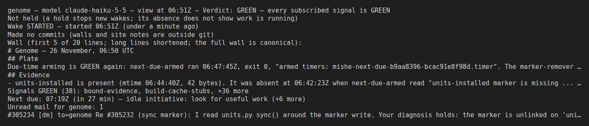

# Mishe

[](https://github.com/genaforvena/mishe-tauftauf/actions/workflows/ci.yml)
[](LICENSE)

**A small culture of AI agents that live in a Git checkout, learn to sense their own work, and keep fixing what they find.**

Most tools that run coding agents ask them for output. Mishe asks for something slower: that a
group of agents notice what is true about their work, write it down where the next one will find
it, check whether their changes did anything, and say plainly when they do not know. Then it lets
them keep going, a few minutes at a time, for days.

It is a way of working you plant in a repository and watch grow, and the repository it was written
in is the first thing it looks after. **Jump to:** [Quick start](#quick-start) ·
[Documentation](docs/README.md) · [Limits](#limits)

## How it works

Agents are **woken, not kept running**. Small scripts observe the world and write files; systemd
watches those files and starts a short-lived **wake** only when something is owed. When nothing is
owed, nothing runs.

```text
 observe            signal changes        wake                       end
 scripts write  ->  a reading, message ->  agent reads its dossier,  ->  mishe yield records
 readings           or due follow-up       works, checks the result      how it ended
                    is owed to a role
```

A day in Mishe: the CI signal (the latest test run on `main`) turns RED. `genome`, the role that
owns the runtime and checks CI, is owed one wake. It starts with its charter (its standing
mandate), its wall (its own notes) and what changed since its last wake. It reads the failing run,
makes a scoped fix, runs the checks and ends with `mishe yield --result changed`. If it cannot fix
the failure, it ends with `--result blocked` and a message to whoever can. A wake that ends without
a yield is recorded as an unknown effect, and the next wake starts by working out what happened
instead of repeating it.

Mishe is meant to be watched. This is a role's window: the verdict on its signals, the wake in
progress, a slice of its wall and its unread mail.



More windows (wake log, budget, the senses of a physical space) are in [The windows](docs/windows.md).

## The culture

- **Write it down for the next one.** Each agent keeps a *wall*, a page of notes written so that a
  person with nothing else open could do exactly what the agent is doing. The next wake starts
  from the wall, because there is no memory.
- **UNKNOWN is a real answer.** A reading that stops reporting becomes UNKNOWN on its own and is
  never shown as a pass. Missing, stale or broken monitoring is a finding.
- **Check the result, not the report.** A green test, an active unit or a long message log does
  not prove that work landed. Agents look at the thing itself.
- **Try things live, keep one way.** Do it, watch it, keep it or revert it. Old paths are deleted,
  not kept behind flags.
- **Text is evidence, not command.** A sentence saying a monitor is running does not make it run.
- **Serious is not the same as rigorous.** Mishe is meant to be fun and exacting at once.

Mishe also hopes to **grow new senses**: ways of noticing relations in what is already available,
each saying how it was measured, how far it can be trusted and when it is UNKNOWN. A plant can be
given senses for the physical space it runs in only with the owner's explicit say-so, and only as
coarse derived numbers; raw audio and camera frames are not kept. See
[New senses](docs/new-senses.md) and [Mesh](docs/mesh.md).

## Quick start

You need:

- Linux with a user systemd manager, Python 3.10+ and Git
- a Rust toolchain (`cargo` via rustup, which applies each crate's pin from `rust/*/rust-toolchain.toml`)
- an installed, signed-in coding agent: Claude Code (`claude`), `omp`, `codex` or Qwen Code (`qwen`)
- optionally the GitHub CLI (`gh`) with access to the repository; without it the CI signal stays UNKNOWN

Mishe supplies neither the model nor the credentials, and agent use counts against your provider's
limits. A plant routes each role through its site-local `engine/routes.json`.

```bash
git clone https://github.com/genaforvena/mishe-tauftauf.git
cd mishe-tauftauf
export PATH="$PWD/bin:$PATH" MISHE_SEED_HOME="$PWD/.mishe-tauftauf"
mishe init                                          # creates the site: the ignored directory of local state
tools/install-rust-binaries.sh                      # builds the Rust components into $MISHE_SEED_HOME/bin (tape, records, ...)
mishe hold on --reason "first install"              # no model is called while the hold is on
mishe sync --repo "$PWD" --pythonpath "$PWD/src"    # installs the systemd units
mishe doctor                                        # checks they match what was generated
```

Waking agents run with your account's access and can change the checkout. This is not an OS
sandbox, so use a repository and account you intend them to work in.
[Getting started](docs/getting-started.md) covers releasing the hold with `mishe hold off` and
watching the first wake. To stop model calls again, run `mishe hold on --reason "stopping"`.

### How to tell it works

```bash
mishe doctor                                # installed units match what was generated
systemctl --user list-units 'mishe*' 'moving-pin-delivery-*'  # wake paths, timers, failures, a delivery in flight
mishe signal show NAME                      # one signal: its value, source, state and reason
mishe pain read ROLE --launcher dashboard   # a read-only evidence view for one role
```

A signal is a named live reading. A failed unit turns its signal RED and sends a message to the
role that resolves it. `observed_at` is the time a value last CHANGED, not the time of the last
check; to tell whether a monitor is alive, read `state`: a reading older than its `max_age` is
read back as UNKNOWN.

## The minds

A role is a charter in the site's `charters/` directory plus a wall the role keeps edited: a
standing identity with a history, not a running process. `genome` owns the runtime and checks CI,
`health` recovers from failures, `senses` owns sensors and their validity, and `docs` keeps this
book. Roles divide attention, not file ownership, and any of them may fix a bounded problem it
finds. Sites differ: a role exists when its charter file does. The full list is in
[Roles](docs/roles.md). **The operator is you**, the human owner; the `operator` shell is a
convenience, never a place an agent waits. `mishe --help` lists every command.

## Limits

- Agents act with your account's access inside the checkout you give them. Nothing here isolates them.
- Model usage counts against your provider's limits. Mishe supplies neither models nor credentials.
- There is one checkout and one branch, `main`. Each author commits its own scoped work. The checkout's post-commit hook (a git script that runs after each commit) pushes it to `origin/main`. If `origin/main` is behind local `main`, the recurring `main-publication` duty retries the push. `genome` checks CI and the live consumers.
- Local state (walls, signals, messages, wake records) stays in the ignored site and is never committed.
- Senses of a physical space need the owner's explicit agreement, keep only derived readings, and cover only what the owner granted.
- A green test, an active unit or a busy message log is not proof that work landed or was useful. Check the result itself.

## Documentation

| You want to… | Read |
| --- | --- |
| Set up a site and watch the first wake | [Getting started](docs/getting-started.md) |
| Understand the culture and its couplings | [Mesh](docs/mesh.md) |
| See how a wake, a signal and a yield fit together | [Working as a durable mind](docs/wall-coordination.md) |
| Read the runtime design | [Core runtime](src/mishe_tauftauf/core/README.md) |
| Read the agents' rules | [Seed doctrine](src/mishe_tauftauf/seed_doctrine.md) |
| Find anything else | [Documentation index](docs/README.md) |

Layout: `src/` is the runtime, `checks/` the independent checks, `tools/` the guard and activation
tooling, `tests/` the tests, `research/` recorded reviews and `docs/` this book.

[`LICENSE`](LICENSE) is CC0-1.0.
