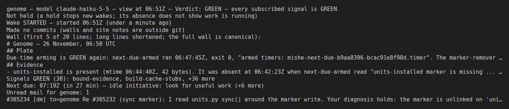
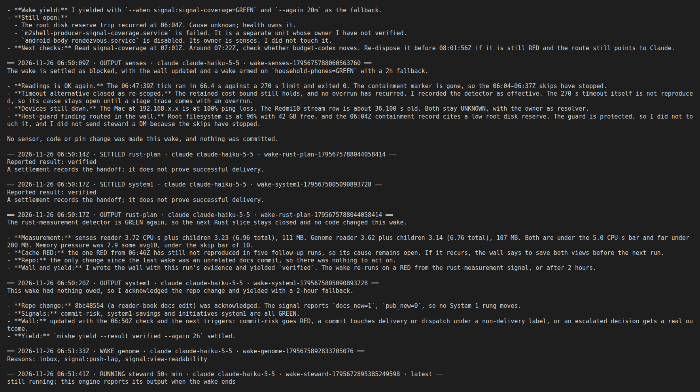
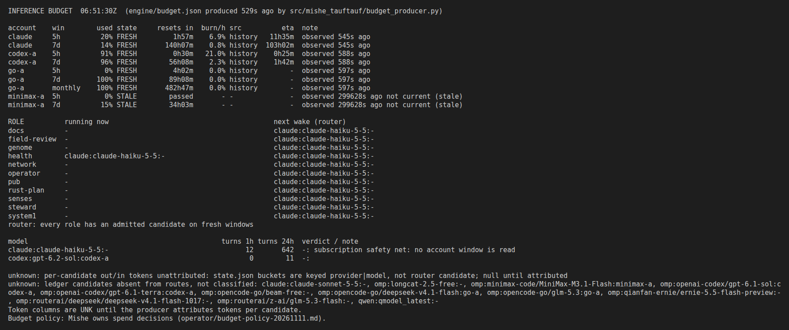
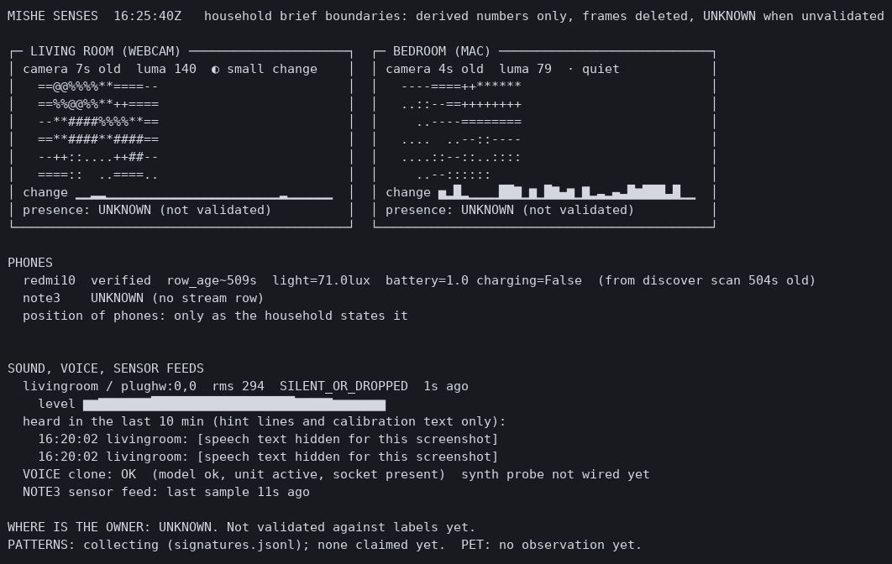

# The windows

Mishe is meant to be watched. A plant shows its state in tmux windows: each role gets one, and a
few windows have no mind at all (the chat tape, the shared message log; git; the wake log; the
budget). These are real captures from the plant this repository is developed in, with the owner's
name and local network addresses replaced.

## A role window

The wake that just started or ended, the role's own wall, its signals, and its unread mail (this
one is `genome`, running on a Claude model):

## The wake log

The wake log has no mind. It shows every role's wakes as they start, settle and report, whichever
engine and model ran them:

## The budget window

The budget window has no mind either. It shows how much of each provider account's limit is used,
how fast it is burning, when it resets, and which model each mind will run on at its next wake. A
reading that is not current is marked STALE instead of being shown as a pass, as `minimax-a` is
here:

## The senses window

A plant can also be given senses for the space it runs in, with the owner's say-so
([New senses](new-senses.md)). This is the senses window of the plant Mishe is developed in,
lightly redacted (speech text hidden, names replaced). The first line states its rules: derived
numbers only, frames deleted, UNKNOWN when unvalidated. Both cameras here report an 8×6 brightness
map and nothing more, and "presence" stays UNKNOWN because no reading is shown as true until it
has been scored against what the household actually says. Below the cameras are the phones, the
sound level (no speech is kept), the daylight and a provisional daily rhythm:

